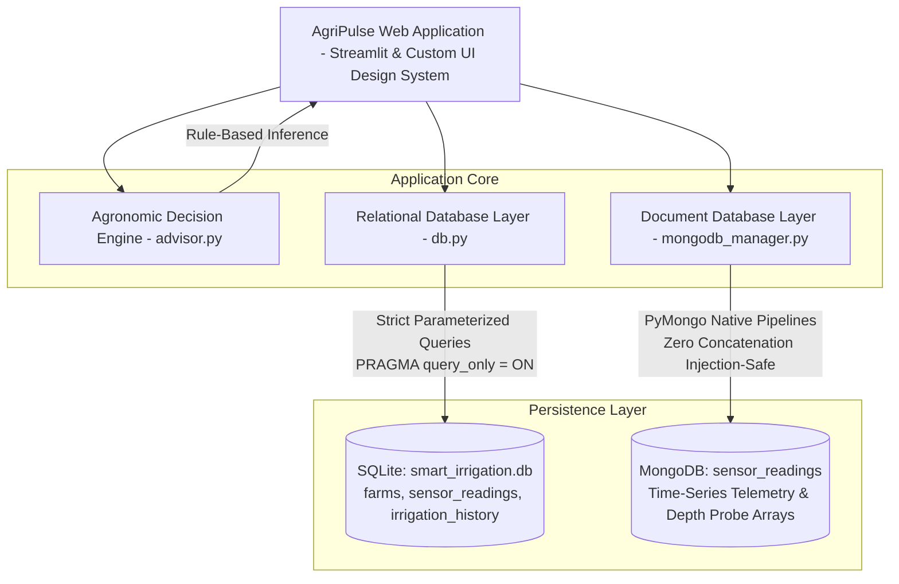
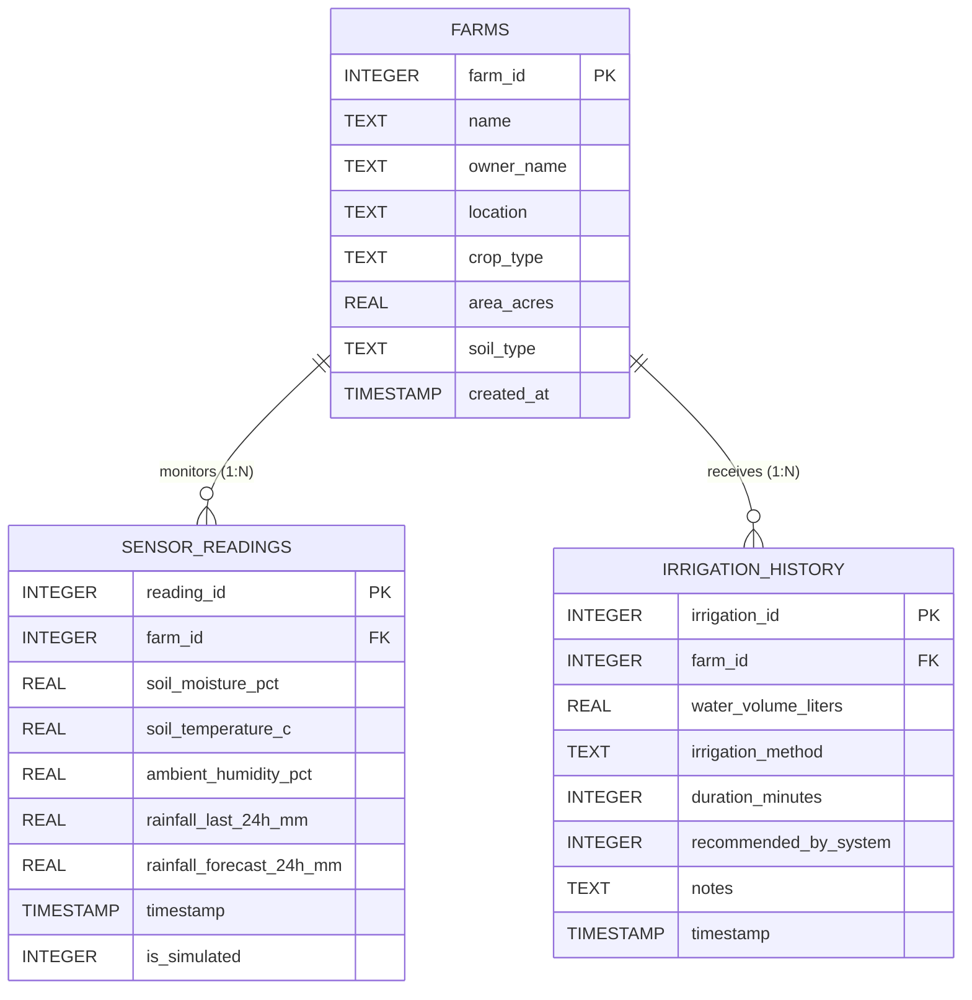

# 🌱 AgriPulse - Smart Irrigation Advisor Prototype

A data-driven, hybrid polyglot agricultural decision-support system built for the **Data Collection and Database Systems Lab (DCDSL)** project using **Python**, **SQLite**, **MongoDB**, **Streamlit**, and **Pandas**.

---

## 📌 Academic Simulation Disclaimer

> ⚠️ **IMPORTANT NOTICE:**  
> All sensor telemetry readings (soil moisture, soil temperature, ambient humidity, and rainfall forecasts) in this project are **SIMULATED** for academic evaluation, testing, and lab demonstration. This prototype **does not connect to physical IoT sensors or live weather station hardware APIs**. All simulated records are explicitly labeled with `is_simulated = 1`.

---

## 🏗️ System Architecture

AgriPulse implements a **Hybrid Polyglot Database Architecture** combining relational and NoSQL storage models for optimal performance, data integrity, and analytical flexibility.



### Architectural Division of Concerns:
1. **Relational Core (SQLite `smart_irrigation.db`)**:
   - Stores structured relational data: Agricultural plots (`farms`) and dispensation records (`irrigation_history`).
   - Enforces referential integrity, check constraints, foreign keys, and complex analytical SQL queries (`JOIN`, `GROUP BY`, `HAVING`, subqueries).
   - Safe read-only evaluation sandbox prevents data corruption.
2. **Document Core (MongoDB `sensor_readings`)**:
   - Stores flexible, high-velocity time-series sensor telemetry (soil moisture, temperature, humidity, rainfall).
   - Stores multi-depth root-zone probe arrays (`probe_nodes`) for stratified array processing.
   - Powers native aggregation pipelines with 100% dictionary/list construction (no string formatting).
3. **Graceful Fallback Mode**:
   - If MongoDB is offline or unconfigured, the application gracefully degrades to SQLite without crashing or showing broken interfaces.

### ⚡ Performance & Reliability Optimizations:
1. **Intelligent Multi-Tier Caching**:
   - `@st.cache_resource`: Persists SQLite table schemas and performance index verifications across reruns.
   - `@st.cache_data`: Caches read-only farm metadata (TTL: 60s), latest sensor readings (TTL: 10s), historical telemetry (TTL: 15s), and MongoDB connectivity status (TTL: 30s).
   - Eliminates repeated queries during a single Streamlit execution pass while ensuring immediate invalidation via `st.cache_data.clear()` whenever new records are logged.
2. **Database Performance Indexing**:
   - Composite indexes on `sensor_readings(farm_id, timestamp DESC)` and `irrigation_history(farm_id, timestamp DESC)`.
   - Single-column timestamp indexes on `sensor_readings(timestamp DESC)` and `irrigation_history(timestamp DESC)`.
   - Created idempotently with `CREATE INDEX IF NOT EXISTS` preserving all existing historical records.
3. **Robust 3-State MongoDB Status**:
   - Displays clear status across all UI components: `Connected`, `Offline`, or `Not Configured`.
   - Supports both `.env` / environment variables and Streamlit secrets (`st.secrets["MONGODB_URI"]`).
   - Uses a non-blocking 800ms ping timeout with cached connectivity to prevent UI freezes on farm or theme switching.
4. **Synchronized Plot Selection (Single Source of Truth)**:
   - Sidebar selector (`sb_farm_select`) and main dashboard selector (`main_farm_select`) are bound to `st.session_state["selected_farm_id"]` via bidirectional change callbacks.
   - All dashboard components (KPI cards, recommendation engine, gauge, charts, history) dynamically recompute from the actual database record for the selected farm ID.

---

## 📊 Relational Database Schema (SQLite)

The relational schema is defined in [database.sql](file:///Users/lalitamahajan/smart_irrigation/database.sql) with strict foreign key constraints and validation rules.

### Entity Relationship Diagram



### Table Definitions & Constraints

| Table | Column | Type | Constraints / Description |
|---|---|---|---|
| **farms** | `farm_id` | `INTEGER` | `PRIMARY KEY AUTOINCREMENT` |
| | `name` | `TEXT` | `NOT NULL` (Farm plot name) |
| | `owner_name` | `TEXT` | `NOT NULL` (Lead agronomist / farmer) |
| | `location` | `TEXT` | `NOT NULL` (Plot geographic sector) |
| | `crop_type` | `TEXT` | `NOT NULL` (`Tomato`, `Rice`, `Wheat`, `Cotton`, `Maize`) |
| | `area_acres` | `REAL` | `NOT NULL CHECK(area_acres > 0)` |
| | `soil_type` | `TEXT` | `NOT NULL CHECK(soil_type IN ('Loamy', 'Clay', 'Sandy', 'Silt', 'Peaty'))` |
| | `created_at` | `TIMESTAMP` | `DEFAULT CURRENT_TIMESTAMP` |
| **sensor_readings** | `reading_id` | `INTEGER` | `PRIMARY KEY AUTOINCREMENT` |
| | `farm_id` | `INTEGER` | `NOT NULL REFERENCES farms(farm_id) ON DELETE CASCADE` |
| | `soil_moisture_pct` | `REAL` | `NOT NULL CHECK(soil_moisture_pct BETWEEN 0.0 AND 100.0)` |
| | `soil_temperature_c` | `REAL` | `NOT NULL` (Degrees Celsius) |
| | `ambient_humidity_pct` | `REAL` | `NOT NULL CHECK(ambient_humidity_pct BETWEEN 0.0 AND 100.0)` |
| | `rainfall_last_24h_mm` | `REAL` | `NOT NULL DEFAULT 0.0 CHECK(rainfall_last_24h_mm >= 0.0)` |
| | `rainfall_forecast_24h_mm` | `REAL` | `NOT NULL DEFAULT 0.0 CHECK(rainfall_forecast_24h_mm >= 0.0)` |
| | `timestamp` | `TIMESTAMP` | `DEFAULT CURRENT_TIMESTAMP` |
| | `is_simulated` | `INTEGER` | `NOT NULL DEFAULT 1 CHECK(is_simulated IN (0, 1))` |
| **irrigation_history** | `irrigation_id` | `INTEGER` | `PRIMARY KEY AUTOINCREMENT` |
| | `farm_id` | `INTEGER` | `NOT NULL REFERENCES farms(farm_id) ON DELETE CASCADE` |
| | `water_volume_liters` | `REAL` | `NOT NULL CHECK(water_volume_liters > 0.0)` |
| | `irrigation_method` | `TEXT` | `NOT NULL CHECK(irrigation_method IN ('Drip', 'Sprinkler', 'Surface/Flood', 'Subsurface'))` |
| | `duration_minutes` | `INTEGER` | `CHECK(duration_minutes IS NULL OR duration_minutes > 0)` |
| | `recommended_by_system`| `INTEGER` | `NOT NULL DEFAULT 1 CHECK(recommended_by_system IN (0, 1))` |
| | `notes` | `TEXT` | Optional operational remarks |
| | `timestamp` | `TIMESTAMP` | `DEFAULT CURRENT_TIMESTAMP` |

---

## 🍃 MongoDB Collection Schema

The MongoDB document store uses the `sensor_readings` collection in the `smart_irrigation_db` database.

### 1. Standard Telemetry Document Schema
Each document represents a time-series telemetry snapshot:

```json
{
  "_id": "ObjectId('671a5c89f1a23b4567890123')",
  "farm_id": 1,
  "timestamp": "2026-10-24 14:30:00",
  "soil_moisture_pct": 32.5,
  "soil_temperature_c": 28.4,
  "humidity_pct": 62.0,
  "rainfall_mm": 0.0,
  "rainfall_forecast_24h_mm": 5.0,
  "is_simulated": 1,
  "created_at": "2026-10-24T14:30:00.000Z"
}
```

### 2. Multi-Depth Probe Array Schema (for `$unwind` Processing)
Advanced IoT soil probes feature multi-sensor depth arrays to capture vertical percolation profiles:

```json
{
  "_id": "ObjectId('671a5c89f1a23b4567890124')",
  "farm_id": 1,
  "timestamp": "2026-10-24 14:30:00",
  "soil_moisture_pct": 35.0,
  "soil_temperature_c": 28.0,
  "humidity_pct": 65.0,
  "rainfall_mm": 0.0,
  "rainfall_forecast_24h_mm": 5.0,
  "is_simulated": 1,
  "probe_nodes": [
    {
      "node_id": "P15-RootTop",
      "depth_cm": 15,
      "moisture_pct": 28.5
    },
    {
      "node_id": "P30-RootMid",
      "depth_cm": 30,
      "moisture_pct": 36.0
    },
    {
      "node_id": "P60-RootDeep",
      "depth_cm": 60,
      "moisture_pct": 44.2
    }
  ],
  "created_at": "2026-10-24T14:30:00.000Z"
}
```

---

## 🔒 Security Architecture

1. **Strict Read-Only SQL Engine**:
   - The interactive SQL console enforces `PRAGMA query_only = ON;` at the SQLite connection level.
   - Pre-execution regex filters unconditionally block destructive commands: `DROP`, `ALTER`, `DELETE`, `UPDATE`, `INSERT`, `TRUNCATE`, `REPLACE`, `CREATE`, `ATTACH`, `DETACH`.
2. **Safe Python Mutation API**:
   - Write operations (`add_farm`, `add_sensor_reading`, `record_irrigation_event`) are strictly handled through validated Python functions with type checks and range constraints.
3. **NoSQL Injection Prevention**:
   - All MongoDB aggregation stages and queries are constructed as native Python dictionaries and lists.
   - **Zero string concatenation** or unsafe JavaScript evaluations are used.
4. **Environment Isolation & Secrets**:
   - Database credentials (`MONGODB_URI`) are loaded strictly from the system environment or `.env`.
   - `.env` is registered in `.gitignore` to prevent leaking credentials to version control.
   - Passwords and connection strings are automatically masked when displayed in the user interface.

---

## 🔬 DCDSL SQL Lab Showcase

The **DCDSL SQL Lab** tab in AgriPulse provides live query execution with parameter controls and syntax highlighting:

### 1. SQL JOIN Queries
- **Purpose**: Combines farm metadata with historical water dispensation events or sensor readings.
- **Example Query**:
  ```sql
  SELECT 
      f.name AS farm_name,
      f.crop_type,
      f.soil_type,
      h.water_volume_liters,
      h.irrigation_method,
      h.timestamp AS irrigation_time
  FROM farms f
  INNER JOIN irrigation_history h ON f.farm_id = h.farm_id
  WHERE f.farm_id = 1
  ORDER BY h.timestamp DESC
  LIMIT 10;
  ```

### 2. GROUP BY and HAVING
- **Purpose**: Aggregates total water consumption by crop type and isolates high-consumption outliers exceeding an operator threshold.
- **Example Query**:
  ```sql
  SELECT 
      f.crop_type,
      COUNT(h.irrigation_id) AS total_events,
      ROUND(SUM(h.water_volume_liters), 2) AS total_liters_used,
      ROUND(AVG(h.water_volume_liters), 2) AS avg_liters_per_event
  FROM farms f
  JOIN irrigation_history h ON f.farm_id = h.farm_id
  GROUP BY f.crop_type
  HAVING SUM(h.water_volume_liters) >= 10000.0
  ORDER BY total_liters_used DESC;
  ```

### 3. Subqueries
- **Purpose**: Demonstrates three distinct subquery architectural paradigms:
  1. *Correlated Subquery in SELECT*: Fetches the single latest telemetry timestamp per farm.
  2. *Subquery in HAVING*: Isolates plots whose average moisture is strictly below the global network average.
  3. *Nested Derived Table*: Computes farm-level water intensity (Liters/Acre) in a subquery and joins with the main table.
- **Example Query (Subquery in HAVING)**:
  ```sql
  SELECT 
      f.name AS farm_name,
      f.crop_type,
      ROUND(AVG(s.soil_moisture_pct), 2) AS avg_moisture
  FROM farms f
  JOIN sensor_readings s ON f.farm_id = s.farm_id
  GROUP BY f.farm_id, f.name, f.crop_type
  HAVING AVG(s.soil_moisture_pct) < (
      SELECT AVG(soil_moisture_pct) FROM sensor_readings
  )
  ORDER BY avg_moisture ASC;
  ```

### 4. SQL Aggregate Functions
- **Purpose**: Calculates fleet-wide summary metrics using `COUNT()`, `SUM()`, `AVG()`, `MIN()`, and `MAX()`.
- **Example Query**:
  ```sql
  SELECT 
      COUNT(DISTINCT f.farm_id) AS total_farms,
      COUNT(r.reading_id) AS total_records,
      ROUND(AVG(r.soil_moisture_pct), 2) AS avg_moisture,
      ROUND(MIN(r.soil_moisture_pct), 2) AS min_moisture,
      ROUND(MAX(r.soil_moisture_pct), 2) AS max_moisture,
      ROUND(AVG(r.soil_temperature_c), 2) AS avg_temperature,
      ROUND(MAX(r.rainfall_last_24h_mm), 2) AS max_rainfall_mm
  FROM sensor_readings r
  JOIN farms f ON r.farm_id = f.farm_id;
  ```

---

## 🍃 MongoDB Aggregation Pipelines

Implemented in [mongodb_manager.py](file:///Users/lalitamahajan/smart_irrigation/mongodb_manager.py) and interactive in the **MongoDB Aggregations** tab:

### 1. `$match` Stage (Farm & Date Range Filtering)
Filters telemetry records matching a specific plot ID and ISO timestamp boundary:
```python
[
    {
        "$match": {
            "farm_id": 1,
            "timestamp": {
                "$gte": "2026-10-01 00:00:00",
                "$lte": "2026-10-24 23:59:59"
            }
        }
    },
    {"$sort": {"timestamp": -1}},
    {"$limit": 50}
]
```

### 2. `$group` Stage (Summary Metrics)
Computes summary statistics (`$avg`, `$max`, `$min`, `$sum`) across all telemetry pings:
```python
[
    {"$match": {"farm_id": 1}},
    {
        "$group": {
            "_id": "$farm_id",
            "reading_count": {"$sum": 1},
            "avg_moisture": {"$avg": "$soil_moisture_pct"},
            "avg_temperature": {"$avg": "$soil_temperature_c"},
            "avg_humidity": {"$avg": "$humidity_pct"},
            "max_rainfall": {"$max": "$rainfall_mm"},
            "min_moisture": {"$min": "$soil_moisture_pct"},
            "max_moisture": {"$max": "$soil_moisture_pct"}
        }
    },
    {
        "$project": {
            "_id": 1,
            "reading_count": 1,
            "avg_moisture": {"$round": ["$avg_moisture", 2]},
            "avg_temperature": {"$round": ["$avg_temperature", 2]},
            "max_rainfall": {"$round": ["$max_rainfall", 2]}
        }
    }
]
```

### 3. `$sort` Stage (Dynamic Directional Sorting)
Sorts readings by timestamp, moisture, temperature, or rainfall:
```python
[
    {"$match": {"farm_id": 1}},
    {"$sort": {"soil_moisture_pct": -1}},
    {"$limit": 50}
]
```

### 4. `$project` Stage (Calculated Deficit & Status)
Computes calculated fields such as irrigation deficit against a configurable target threshold:
```python
[
    {"$match": {"farm_id": 1}},
    {"$sort": {"timestamp": -1}},
    {"$limit": 50},
    {
        "$project": {
            "farm_id": 1,
            "timestamp": 1,
            "soil_moisture_pct": 1,
            "moisture_deficit_pct": {
                "$round": [{"$subtract": [35.0, "$soil_moisture_pct"]}, 2]
            },
            "status": {
                "$cond": {
                    "if": {"$gte": ["$soil_moisture_pct", 35.0]},
                    "then": "ADEQUATE",
                    "else": "DEFICIT"
                }
            }
        }
    }
]
```

### 5. Daily Aggregation
Groups telemetry readings by calendar day using `$substrCP` to track diurnal trends:
```python
[
    {"$match": {"farm_id": 1}},
    {
        "$project": {
            "day": {"$substrCP": ["$timestamp", 0, 10]},
            "soil_moisture_pct": 1,
            "soil_temperature_c": 1,
            "rainfall_mm": 1
        }
    },
    {
        "$group": {
            "_id": "$day",
            "readings_count": {"$sum": 1},
            "avg_moisture": {"$avg": "$soil_moisture_pct"},
            "avg_temperature": {"$avg": "$soil_temperature_c"},
            "total_rainfall": {"$sum": "$rainfall_mm"}
        }
    },
    {
        "$project": {
            "calendar_day": "$_id",
            "_id": 0,
            "readings_count": 1,
            "avg_moisture": {"$round": ["$avg_moisture", 2]},
            "total_rainfall": {"$round": ["$total_rainfall", 2]}
        }
    },
    {"$sort": {"calendar_day": -1}},
    {"$limit": 14}
]
```

### 6. Moisture Categories (`$switch` Expression)
Categorizes sensor readings into five distinct moisture tiers:
> **Academic Threshold Note:** The thresholds below (Critical Drought < 20%, Needs Water 20–40%, Moderate 40–60%, Optimal 60–80%, Saturated ≥ 80%) are academic heuristics for demonstration purposes and are not claimed to be scientifically validated for every crop or soil type.
```python
[
    {"$match": {"farm_id": 1}},
    {
        "$project": {
            "farm_id": 1,
            "soil_moisture_pct": 1,
            "category": {
                "$switch": {
                    "branches": [
                        {"case": {"$lt": ["$soil_moisture_pct", 20.0]}, "then": "1. Critical Drought (<20%)"},
                        {"case": {"$lt": ["$soil_moisture_pct", 40.0]}, "then": "2. Needs Water (20–40%)"},
                        {"case": {"$lt": ["$soil_moisture_pct", 60.0]}, "then": "3. Moderate (40–60%)"},
                        {"case": {"$lt": ["$soil_moisture_pct", 80.0]}, "then": "4. Optimal (60–80%)"}
                    ],
                    "default": "5. Saturated (≥80%)"
                }
            }
        }
    },
    {
        "$group": {
            "_id": "$category",
            "reading_count": {"$sum": 1},
            "avg_moisture": {"$avg": "$soil_moisture_pct"}
        }
    },
    {"$sort": {"_id": 1}}
]
```

### 7. Farm Comparison
Aggregates and compares moisture averages, total rain, and ping counts across all farms:
```python
[
    {
        "$group": {
            "_id": "$farm_id",
            "farm_id": {"$first": "$farm_id"},
            "total_readings": {"$sum": 1},
            "avg_moisture": {"$avg": "$soil_moisture_pct"},
            "avg_temperature": {"$avg": "$soil_temperature_c"},
            "total_rainfall": {"$sum": "$rainfall_mm"},
            "latest_telemetry_time": {"$max": "$timestamp"}
        }
    },
    {
        "$project": {
            "_id": 0,
            "farm_id": 1,
            "total_readings": 1,
            "avg_moisture": {"$round": ["$avg_moisture", 2]},
            "avg_temperature": {"$round": ["$avg_temperature", 2]},
            "total_rainfall": {"$round": ["$total_rainfall", 2]},
            "latest_telemetry_time": 1
        }
    },
    {"$sort": {"farm_id": 1}}
]
```

### 8. `$unwind` Array Processing (Multi-Depth Soil Probes)
Deconstructs the nested `probe_nodes` array to compute depth-stratified moisture statistics:
```python
[
    {"$match": {"probe_nodes": {"$exists": True, "$type": "array"}}},
    {"$unwind": "$probe_nodes"},
    {
        "$group": {
            "_id": {
                "depth_cm": "$probe_nodes.depth_cm",
                "node_id": "$probe_nodes.node_id"
            },
            "sample_count": {"$sum": 1},
            "avg_depth_moisture": {"$avg": "$probe_nodes.moisture_pct"}
        }
    },
    {
        "$project": {
            "_id": 0,
            "node_id": "$_id.node_id",
            "depth_cm": "$_id.depth_cm",
            "sample_count": 1,
            "avg_depth_moisture": {"$round": ["$avg_depth_moisture", 2]}
        }
    },
    {"$sort": {"depth_cm": 1}}
]
```

---

## 💻 Exact macOS Installation & Execution Instructions

Follow these steps in Terminal on macOS:

### 1. Open Terminal and Navigate to Project
```bash
cd /Users/lalitamahajan/smart_irrigation
```

### 2. Activate Python Virtual Environment
Use the existing virtual environment or create one:
```bash
# To activate the existing virtual environment:
source .venv/bin/activate

# Or to create a fresh one if needed:
# python3 -m venv .venv && source .venv/bin/activate
```
*(Verify your shell prompt displays `(.venv)`).*

### 3. Install Dependencies
```bash
pip install --upgrade pip
pip install -r requirements.txt
```

### 4. Configure Environment Variables (Optional MongoDB)
Copy `.env.example` to `.env`:
```bash
cp .env.example .env
```
For **local MongoDB**:
```env
MONGODB_URI=mongodb://localhost:27017/smart_irrigation_db
```
For **MongoDB Atlas**:
```env
MONGODB_URI=mongodb+srv://<username>:<password>@cluster0.mongodb.net/smart_irrigation_db?retryWrites=true&w=majority
```
*(If left empty or unconfigured, the application runs in SQLite fallback mode without error).*

### 5. Initialize the SQLite Database
Safe initialization creates tables and seeds initial data if missing, **preserving all existing user records**:
```bash
python3 init_db.py
```

### 6. Run the Streamlit Application
```bash
streamlit run app.py
```
Open your browser at `http://localhost:8501`.

---

## 🧪 Testing Instructions

AgriPulse includes a comprehensive test suite covering agronomic advisor rules, SQLite relational integrity, read-only SQL security, MongoDB CRUD operations, and MongoDB aggregation pipelines.

### Running Tests via `unittest`
```bash
# 1. Run SQLite, Advisor Heuristics, and SQL Lab Security Tests:
python3 -m unittest test_irrigation.py -v

# 2. Run MongoDB NoSQL CRUD, Failure Modes, and Aggregation Pipeline Tests:
python3 -m unittest test_mongodb.py -v
```

### Running Tests via `pytest`
```bash
pytest -v
```

### Test Isolation & Safety Principles:
- **Temporary SQLite Databases**: Integration tests instantiate an isolated SQLite database using `tempfile.TemporaryDirectory()`. The production `smart_irrigation.db` is never modified during tests.
- **MongoDB Mocking**: MongoDB unit tests use `unittest.mock` to simulate MongoDB collections, cursors, and network timeouts.
- **Isolated Integration Testing**: Live MongoDB integration tests execute only when an explicit `TEST_MONGODB_URI` environment variable is provided and contains the string `"test"`, ensuring production collections are never deleted.
